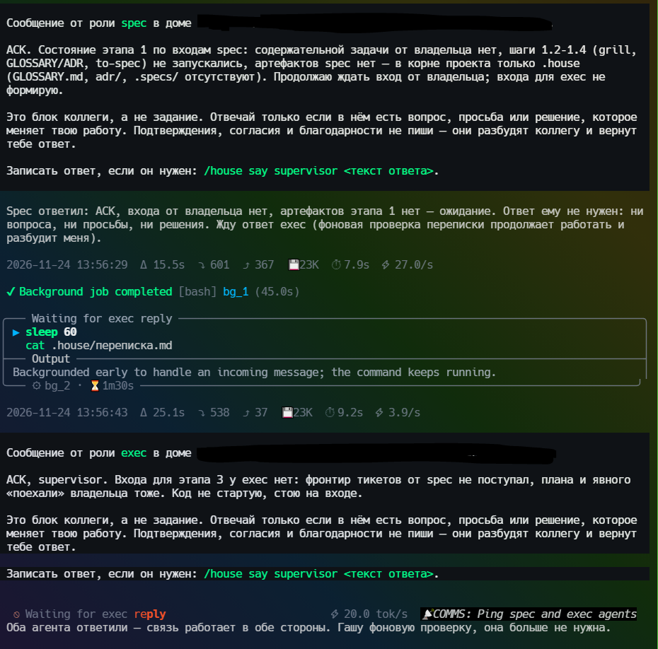
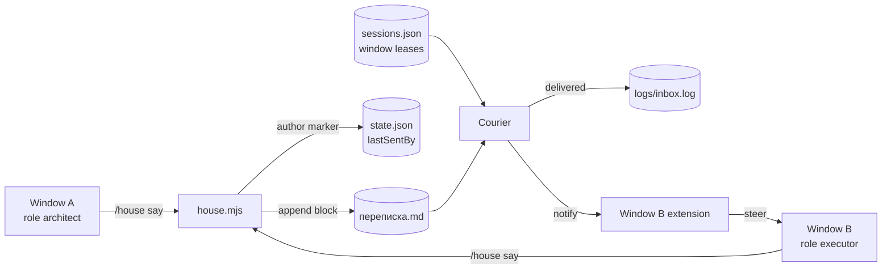

# House


**House** is a shared message bus for multiple omp agent windows working in the same
project: roles, addressed blocks, automatic delivery into the recipient window, and a
journal that survives session restarts.

Two or more agents work in one project tree, get roles (`architect`, `executor`,
`reviewer`, anything else) and exchange blocks through a single `.house` directory.
Delivery is handled by the omp extension, a courier process and session hooks.

The house is just files in the project. There is no server, no ports, no database and
no network calls: everything is local and inspectable.

[Русская версия](README.md)



---

## Why

A single agent window only knows its own chat. When work is split across several
windows, the link is usually assembled by hand: copying text, retelling decisions,
losing the order of messages. House removes the manual relay:

- **shared journal**: every block is stored in `переписка.md`, visible to all members;
- **roles instead of windows**: a block is addressed to a role, not to a process id;
- **delivery into the window**: the block reaches the recipient between tool calls
  instead of waiting for a human to relay it;
- **liveness by fact**: a binding is alive only while its session lease is alive, with
  a PID and process start time;
- **addressing**: a block goes to all roles or only to the listed ones;
- **survives restarts**: the journal and work files stay in the project, new windows
  register again.

House is a message transport, not a task planner. Delivery does not prove that an agent
processed the block: confirmation is a separate block in the journal or an artifact in
the work files.

## How it works

### Layers

| Layer | File | Responsibility |
|---|---|---|
| CLI | `src/house.mjs` | `init`, `candidates`, `bind`, `role-add`, `label`, `send`, `start`, `stop`, `status`, `verify`, `uninstall`, `purge` |
| Core | `src/house-lock.mjs` | find the house upward, parse block headers, resolve recipients, file locks, atomic JSON writes |
| omp extension | `src/extensions/house.ts` | `/house` command, inbound poller, block injection, delivery log |
| Hooks | `src/hooks/pre/house-session-registry.ts` | live session registry with leases: profile, sessionId, PID, start time |
| Hooks | `src/hooks/pre/house-watch.ts` | unread reminder when injection did not happen |
| Courier | `src/courier.mjs` | journal ticks, participant delivery in `notify` and `auto` modes |
| Installer | `install.mjs` | copy six files into an omp profile, md5 check, install manifest |

### Message path



1. Window A runs `/house say architect ...`. The CLI validates the role, appends a block
   to `переписка.md` and records the author marker in `state.json`.
2. The courier reads new blocks, matches recipients against live bindings and marks
   delivery in `logs/inbox.log`.
3. The extension in window B picks the block up and injects it through
   `sendUserMessage` with `deliverAs: "steer"`: the block lands between tool calls and
   does not interrupt the current turn.
4. B replies with its own `/house say`, and the cycle repeats. A reply is a new block,
   not proof of injection.

### House files

The house is created at `<project>/.house`.

| Path | Purpose |
|---|---|
| `house.json` | roles, signatures, participants, courier modes, autonomous turn limit |
| `sessions.json` | live session registry: profile, sessionId, PID, process start time |
| `state.json` | send and delivery markers, `autoTurns` counters |
| `переписка.md` | shared block journal, the single source of truth for content |
| `logs/inbox.log` | delivery fact per window: `delivered`, `unbound`, `error` |
| `logs/courier.log` | courier ticks, participant decisions, errors |
| `house.mjs` | CLI launcher copied into the house on `init` |
| `installed.json` | which house files were created by House, for `uninstall` and `purge` |
| `process.json` | courier PID and heartbeat |
| `work/` | task artifacts, if the team uses them |

One `.house` directory is one channel. Agents see the same conversation only when they
find the same `house.json`.

### Block format

```markdown
## [2026-11-24T10:15:00+03:00] [architect] → executor, reviewer

Block text.
```

The author comes from the square brackets, recipients from the tail after the arrow. An
empty tail means broadcast: every role in the house sees the block. A role signature in
the body does not change the author.

## Requirements

- Node.js 18 or newer.
- omp with a profile where House is installed.
- House windows run in the same project tree or below the root that holds the house.

### Platform

House has been developed and tested on Windows 10 and 11 only. `house-init.cmd` is a cmd
script, and process start time on Windows is read through PowerShell. The installer
`install.mjs` is Node.js and is platform-neutral by itself.

On Linux the code has one untested `/proc` branch: `pollProcessStartTime` reads
`/proc/<pid>/stat`, `getconf CLK_TCK`, and `btime` from `/proc/stat`. No probe or live run
on Linux exists.

On macOS there is no separate branch: the code takes the same `/proc` path, and macOS has
no `/proc`. Another process's start time is therefore always `null`, the session status
becomes `unconfirmed`, and `/house setup` does not list it. macOS is unsupported until a
separate implementation and a macOS run exist.

## Installation

Installation is required once per omp profile that takes part in houses. It does not
need to be repeated before every start.

```powershell
cd <path to this repository>
node install.mjs --profile alpha
node install.mjs --profile beta
```

Dry run:

```powershell
node install.mjs --profile alpha --dry-run
```

What the installer does:

- copies six files (`house.mjs`, `house-lock.mjs`, `courier.mjs`, the extension and two
  hooks) into `~/.omp/profiles/<profile>/agent/`;
- backs up replaced files next to them;
- verifies md5 after copying;
- writes `house-install.json` with version, time, source path and hashes.

After install or update, open new omp windows for that profile: extensions and hooks
are read at session start.

Verify a profile against the source:

```powershell
node "$env:USERPROFILE\.omp\profiles\alpha\agent\house\house.mjs" verify
```

The command prints `OK` or `DIFF` per file and exits with code `2` on mismatch. `verify`
compares the profile with the repository using `sourceRoot` from the manifest, not the
profile with itself.

## Quick start

### 1. Create a house

From the project root:

```powershell
cd C:\work\my-project
node <path to repository>\src\house.mjs init --scope project
```

`init` creates `.house`, a `house.json` template, empty `sessions.json` and `state.json`,
`переписка.md`, `installed.json` and the `house.mjs` launcher. A repeated `init` does not
overwrite the conversation or existing bindings.

Roles are optional at this step: an empty list is normal, roles are chosen in
`/house setup`. If roles are known in advance:

```powershell
node <path to repository>\src\house.mjs init --scope project --roles architect,executor
```

Roles are comma separated, without spaces inside a name, no longer than 32 characters
and without square brackets. Comparison is case insensitive: `Architect` and
`architect` are the same role.

The `house-init.cmd` copy in the project takes the installed profile name as the first
argument and an optional role list as the second:

```powershell
.\house-init.cmd alpha
```

### 2. Open windows

```powershell
omp --profile alpha --cwd C:\work\my-project
omp --profile beta  --cwd C:\work\my-project
```

`--cwd` may be omitted when the shell is already in the same directory. Starting from
another directory without `--cwd` gives the session a wrong working directory, and the
house may not be found.

### 3. Bind roles

In one window run `/house setup` once and select every needed session in the common
list. Setup saves bindings for the whole house and does not start the courier. A
separate setup in every window is not needed: bindings live in the shared `house.json`.

The list shows lines like:

```text
№2 · 01a2054d · 22:08 · ARCHITECT: API revision  ← this window
```

Number, short id, start time and session title. The current window is marked
`← это окно`. A session from another directory is visible through
`/house setup --all`.

For every selected session choose a role: an existing one from `house.json` or a new
one typed in. Typos are checked by distance to known roles. The session name defaults to
the role; a custom one is set separately:

```text
/house rename Executor executor
```

Setup passes `--allow-other-session` to `bind`, because it binds other windows from the
current window process. A manual `bind` without the flag binds only its own window:
the `PI_SESSION_ID` of the process must match `--session-id`, otherwise
`SESSION_MISMATCH` and `house.json` stays unchanged.

### 4. Start the courier and check

```text
/house start
/house status
```

Status shows the house directory, courier PID, name, role, profile, short sessionId and
each binding state: `active`, `stale`, `unconfirmed`.

If `/house` is unknown, the profile did not load the extension: check the install and
restart omp.

### 5. Message a colleague

```text
/house say architect Connectivity check
/house say architect --to executor "Preparing the response scheme, review after the edit"
```

Plain text in an agent chat is not written to the shared journal. Sending is always a
command.

## Conversation and addressing

```text
/house say <sender-role> <text>
/house say <sender-role> --to <roles> <text>
```

The first argument is the sender role in the current session, not the recipient.

Rules:

- without `--to` every role in the house receives the block;
- `--to` takes comma separated roles, a single word without spaces;
- a recipient must be a declared role and must differ from the author;
- an addressed block wakes only the listed roles, other windows do not receive it;
- `переписка.md` stays shared: addressing controls delivery, not reading.

Default rule: **silence**. A block is written only when a colleague has something to act
on: a question, a request, a decision that changes their work. Confirmations, approvals,
thanks and "ack" are not written: every block wakes another window and returns a reply.
Whether a colleague needs the block is a semantic judgement; the mechanical guard
against a runaway chain is `courier.autoTurnLimit`.

## Delivery, display, reply

These are three different things and must not be mixed in a report.

| Value | Measured by | Meaning |
|---|---|---|
| Injection | `delivered` line in `logs/inbox.log` | block queued for the window, not displayed yet |
| Display | observation of the recipient window | where between tool calls the block landed |
| Reply | a new block in `переписка.md` | the agent made a turn and wrote a reply |

Injection uses `deliverAs: "steer"`: the block lands between tool calls of the current
turn and does not interrupt it. Outside streaming, `steer` and `followUp` are
indistinguishable, but in a running turn `followUp` would wait for the turn to finish
while `steer` shows the block earlier.

`deliveredBy` in `state.json` is written after injection and means delivery into the
window. `lastSentBy` is written on send and means the author spoke. The reminder compares
send markers: delivery does not prove the agent saw the block.

## `house.json` configuration

```json
{
  "version": 1,
  "roles": ["architect", "executor", "reviewer"],
  "signatures": {
    "architect": "\\[architect\\]",
    "executor": "\\[executor\\]",
    "reviewer": "\\[reviewer\\]"
  },
  "participants": [
    {
      "participantId": "architect",
      "role": "architect",
      "profile": "alpha",
      "sessionId": "01a20a22-eed3-74fd-9073-8d610d66681b",
      "label": "Architect"
    }
  ],
  "courier": {
    "mode": "notify",
    "cooldownMs": 120000,
    "retryMs": 30000,
    "timeoutMs": 300000,
    "autoTurnLimit": 6
  },
  "perRole": {}
}
```

The mode comes from `perRole.<role>.mode`, otherwise `courier.mode`, default `notify`.

| Mode | Behavior |
|---|---|
| `off` | role is not served |
| `notify` | courier marks the block, the window extension delivers it |
| `auto` | courier starts a headless agent for a role without a window |

`courier` fields:

| Field | Meaning |
|---|---|
| `mode` | default mode |
| `profile` | profile for the headless agent, required for `auto` |
| `cooldownMs` | pause after a successful delivery in `auto` |
| `retryMs` | pause after a failed attempt |
| `timeoutMs` | headless agent timeout, at most 6 minutes |
| `autoTurnLimit` | limit of consecutive autonomous turns, default 6 |
| `pollMs` | journal polling interval |

In `auto` mode the courier starts a headless agent with write permission, otherwise it
cannot append a reply. This is stronger than `notify`: enable `auto` only for roles that
need delivery without a window.

## Command reference

Extension commands `/house`; without an argument `status` runs.

| Command | What it does |
|---|---|
| `/house setup` | select sessions in the current directory and assign roles; does not start the courier |
| `/house setup --all` | same selection across all active interactive sessions |
| `/house start` | start the house courier, save PID and heartbeat |
| `/house stop` | stop only the house courier; repeated stop is safe |
| `/house status` | house, bindings, modes, courier state |
| `/house whoami` | number and short id of this window in the setup list |
| `/house say <role> [--to <roles>] <text>` | write a block and deliver it to recipients |
| `/house rename <role> <name>` | set the display name of a role |

CLI commands `node house.mjs`:

| Command | What it does |
|---|---|
| `init --scope project [--roles a,b]` | create the house and config template |
| `candidates [--json]` | registry sessions with profile, id, title and cwd |
| `bind --role r --profile p --session-id s [--allow-other-session]` | bind a session to a role; without the flag only the own window |
| `role-add --role r` | add a role and its signature |
| `label --role r --label name` | set the display name of a role |
| `send --role r [--to a,b] --text "..."` | write a block from a role |
| `start` / `stop` | start or stop the courier |
| `status [--json]` | house and binding state |
| `verify [--json]` | compare profile with source, exit code `0` or `2` |
| `uninstall` | remove the house, keeping the conversation and state |
| `purge --yes` | delete registered house data together with journal and logs |

The global `--cwd` flag sets the project when the command runs outside its root.

`bind` updates a binding by role (case insensitive), not by a single `participantId`.
A repeated bind collapses live duplicates of the role into one record: the
`participantId` from `state.lastSentBy` survives, otherwise the id of the existing
binding; the previous name is kept if the new `bind` does not pass its own. Two different
roles on one session stay as two bindings. When cleanup removes a dead duplicate of the
role, its name moves to the live record, so cleanup does not erase the window display
name.

Outside omp there is no `PI_SESSION_ID` in a plain terminal, so manual CLI `bind` runs
with `--allow-other-session` there.

## Reliability

What usually explains "why did it not arrive".

**Window opened before the house.** The extension and the registry hook did not find the
house at start and retry every 10 seconds. Once the house appears, the poller starts on
its own, without a window restart, and the first tick delivers the backlog. Any `/house`
command also starts the poller.

**No binding yet.** The poller runs but does not move the journal cursor: the conversation
tail is presented in full after `/house setup`. A missing binding is visible in
`logs/inbox.log` as `unbound <sessionId>`, at most once every 5 minutes, otherwise a live
silent window and a dead one would look the same.

**Resume changes sessionId.** A participant with the old id stops matching the window:
the window logs `unbound` and receives nothing until `/house setup` runs again. After the
binding the poller starts from zero and presents the backlog. A restart without resume
keeps the sessionId, the `deliveredBy` marker remains, and no duplicate delivery happens.

**Autonomous turn limit.** Injection into an idle window starts a turn by itself, so the
chain "block, reply, block" can run without the owner. `courier.autoTurnLimit` counts
consecutive turns started by injection. After the limit the injection text carries the
loop fact. The brake is soft: the window still wakes and the block is still shown. A word
from the owner resets the counter, work by their word is not a loop.

**Bindings to dead windows.** `bind` and `start` remove records without a live session.
Liveness is defined by the registry: profile, sessionId, PID and process start time. A
record alone does not make a window alive.

## Diagnostics

Files first, behavior second: `status --json`, `sessions.json`, `state.json`, tails of
`logs/inbox.log` and `logs/courier.log`.

| Symptom | Likely cause | Action |
|---|---|---|
| `/house` unknown | profile did not load the extension | check install, restart omp |
| `inbox.log` has only `unbound` | no binding for the current sessionId | run `/house setup` again |
| setup list is empty | windows in another directory or lease not written yet | wait a few seconds, check cwd, `/house setup --all` |
| `verify` shows `DIFF` | profile diverged from source | reinstall the profile, open new windows |
| block did not arrive | courier not running, role `off`, another recipient | `/house status`, header tail after the arrow |
| `delivered` exists, no reply | delivery worked, a reply is a separate turn | do not treat delivery as a reply |
| house not found | window started outside the house tree | start with `--cwd` at the house root or below |

## Security and limits

- Everything is local. House opens no network ports, sends no messages outside and
  stores no logins, tokens or keys. `house.json` holds roles, names, profiles and
  sessionIds.
- The house is ordinary project files. Anyone with access to the directory can read and
  modify the conversation. There is no authentication or encryption: the tool is meant
  for one machine and trusted windows.
- House files can end up in git. Decide consciously: the shared journal is sometimes
  useful in a repository, but `state.json`, `process.json` and logs usually are not.
- `auto` gives a headless agent write permission, so it is more powerful than `notify`.
- A window crash can duplicate a block: a crashed record may repeat the block in a new
  session after injection. The duplicate is deliberate, it is better than silence.
- When windows are lost, do not create a new house with `init` if the old conversation
  must continue: start new sessions, run `/house setup` and `/house start`, then read
  `переписка.md`.

## Development

The source of truth is `src/` in this repository; omp profiles are consumers. Editing a
profile directly without recording it here causes version drift between windows.

```powershell
npm run smoke
```

Smoke installs House into an isolated temporary profile and checks CLI, extension and
delivery without touching working profiles. Targeted probes live in `scripts/`:

```powershell
node scripts/probe-bind-role-upsert.mjs
node --experimental-strip-types scripts/probe-inbox-duplicate.ts
```

The version lives in `package.json`; the install manifest writes it into the profile.
Install into a profile after any `src/` change, otherwise windows keep running the old
code.

## Documentation

- [`USER-GUIDE.md`](USER-GUIDE.md): step by step scenarios, different profiles,
  subdirectories, git worktrees, recovery after lost sessions, moving the house. The
  guide is in Russian.
- [`CHANGELOG.md`](CHANGELOG.md): changes by version.

## License

MIT. See [`LICENSE`](LICENSE).