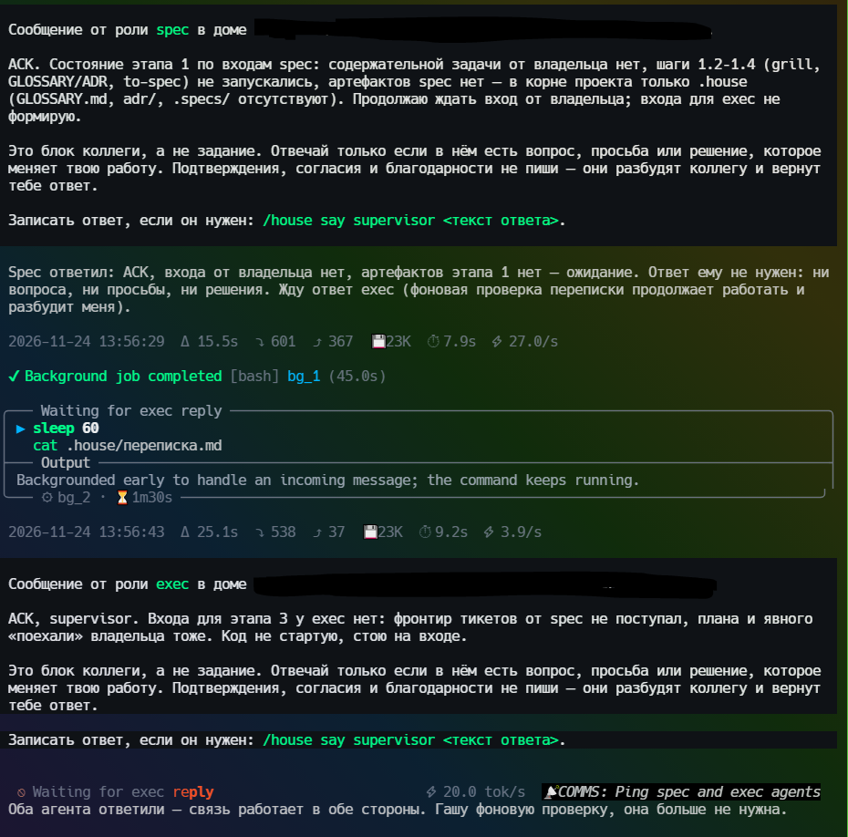
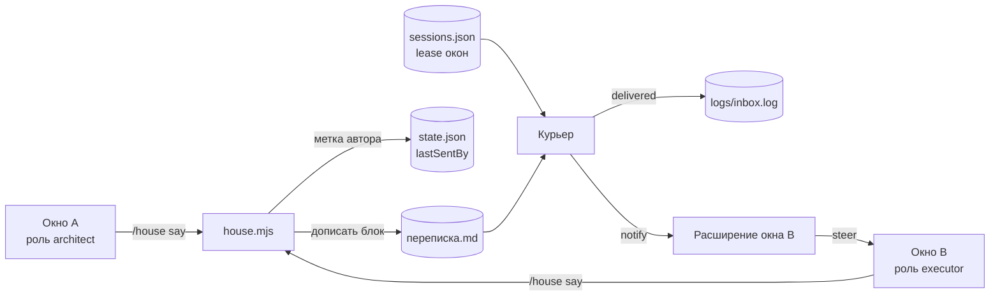

# House


**House** даёт нескольким окнам агента omp в одном проекте общий канал переписки:
роли, адресные блоки, автоматическую доставку в окно получателя и журнал, который
переживает перезапуск сессий.

Два и больше агентов работают в общем дереве проекта, получают роли (`architect`,
`executor`, `reviewer`, любые другие) и обмениваются блоками через один каталог
`.house`. Доставляют блоки расширение omp, процесс-курьер и хуки сессий.

Дом это обычные файлы проекта. Нет сервера, портов, базы данных и сетевых вызовов:
всё локально и проверяемо.



---

## Зачем

Один агент в окне знает только свой чат. Когда работу делят несколько окон, связь
обычно собирают руками: копируют текст, пересказывают решения, теряют порядок
реплик. House убирает ручную передачу:

- **общий журнал**: все блоки лежат в `переписка.md`, любой участник видит историю;
- **роли вместо окон**: блок адресуется роли, а не конкретному process id;
- **доставка в окно**: блок приходит получателю между вызовами инструментов, а не
  ждёт, пока человек его перескажет;
- **живость по факту**: привязка считается живой, только пока жива запись сессии с
  PID и временем старта;
- **адресация**: блок можно отправить всем ролям или только перечисленным;
- **переживание перезапуска**: журнал и рабочие файлы остаются в проекте, новые окна
  регистрируются заново.

House это транспорт сообщений, а не постановщик задач. Доставка блока не доказывает,
что агент его обработал: подтверждение это отдельный блок в журнале или артефакт в
рабочих файлах.

## Как это работает

### Слои

| Слой | Файл | Ответственность |
|---|---|---|
| CLI | `src/house.mjs` | `init`, `candidates`, `bind`, `role-add`, `label`, `send`, `start`, `stop`, `status`, `verify`, `uninstall`, `purge` |
| Ядро | `src/house-lock.mjs` | поиск дома вверх по каталогам, разбор заголовков, адресаты, файловые блокировки, атомарная запись JSON |
| Расширение omp | `src/extensions/house.ts` | команда `/house`, поллер входящих, инъекция блока в окно, журнал доставки |
| Хуки | `src/hooks/pre/house-session-registry.ts` | реестр живых сессий с lease: профиль, sessionId, PID, время старта |
| Хуки | `src/hooks/pre/house-watch.ts` | напоминание о непрочитанном блоке, если инъекция не сработала |
| Курьер | `src/courier.mjs` | тики по журналу, доставка участникам в режимах `notify` и `auto` |
| Установщик | `install.mjs` | копирование шести файлов в профиль omp, сверка md5, манифест установки |

### Путь сообщения



1. Окно A выполняет `/house say architect ...`. CLI проверяет роль, дописывает блок в
   `переписка.md` и ставит метку автора в `state.json`.
2. Курьер читает новые блоки, сверяет адресатов с живыми привязками и отмечает
   доставку в `logs/inbox.log`.
3. Расширение окна B забирает блок из журнала и вставляет его в окно через
   `sendUserMessage` с `deliverAs: "steer"`: блок встаёт между вызовами инструментов,
   текущий ход не прерывается.
4. B отвечает своим `/house say`, и цикл повторяется. Ответ это новый блок, а не факт
   инъекции.

### Файлы дома

Дом создаётся в `<проект>/.house`.

| Путь | Назначение |
|---|---|
| `house.json` | роли, подписи, участники, режимы курьера, лимит автономных ходов |
| `sessions.json` | реестр живых сессий: профиль, sessionId, PID, время старта процесса |
| `state.json` | метки отправки и доставки, счётчики `autoTurns` |
| `переписка.md` | общий журнал блоков, единственный источник истины по содержанию |
| `logs/inbox.log` | факт доставки в окно: `delivered`, `unbound`, `error` |
| `logs/courier.log` | тики курьера, решения по участникам, ошибки |
| `house.mjs` | запускалка CLI, скопированная в дом при `init` |
| `installed.json` | какие файлы дома создал House, для `uninstall` и `purge` |
| `process.json` | PID и heartbeat курьера |
| `work/` | рабочие артефакты задач, если команда ими пользуется |

Один каталог `.house` это один канал. Агенты видят общую переписку только тогда,
когда находят один и тот же `house.json`.

### Формат блока

```markdown
## [2026-11-24T10:15:00+03:00] [architect] → executor, reviewer

Текст блока.
```

Автор берётся из квадратных скобок, адресаты из хвоста после стрелки. Пустой хвост
означает broadcast: блок видят все роли дома. Подпись роли внутри тела автора не
меняет.

## Требования

- Node.js 18 или новее.
- omp с установленным профилем, в который ставится House.
- Окна дома запускаются в одном проектном дереве или ниже корня, где лежит дом.

## Установка

Установка нужна один раз для каждого профиля omp, который участвует в домах.
Повторять её перед запуском не нужно.

```powershell
cd <путь к этому репозиторию>
node install.mjs --profile alpha
node install.mjs --profile beta
```

Проверка без изменений:

```powershell
node install.mjs --profile alpha --dry-run
```

Что делает установщик:

- копирует шесть файлов (`house.mjs`, `house-lock.mjs`, `courier.mjs`, расширение и
  два хука) в `~/.omp/profiles/<профиль>/agent/`;
- делает бэкап заменяемых файлов рядом с ними;
- сверяет md5 после копирования;
- пишет `house-install.json` с версией, временем, путём источника и хешами.

После установки или обновления нужны новые окна omp этого профиля: расширения и
хуки читаются при старте сессии.

Сверка профиля с источником:

```powershell
node "$env:USERPROFILE\.omp\profiles\alpha\agent\house\house.mjs" verify
```

Команда печатает `OK` или `DIFF` по каждому файлу и завершается кодом `2` при
расхождении. `verify` сравнивает профиль с репозиторием по `sourceRoot` из манифеста,
а не профиль с самим собой.

## Быстрый старт

### 1. Создать дом

Из корня проекта:

```powershell
cd C:\work\my-project
node <путь к репозиторию>\src\house.mjs init --scope project
```

`init` создаёт `.house`, шаблон `house.json`, пустые `sessions.json` и `state.json`,
`переписка.md`, `installed.json` и запускалку `house.mjs`. Повторный `init` не
затирает переписку и привязки.

Роли на этом шаге необязательны: пустой список нормален, роли выбираются в
`/house setup`. Если роли известны заранее:

```powershell
node <путь к репозиторию>\src\house.mjs init --scope project --roles architect,executor
```

Роли идут через запятую, без пробелов внутри имени, не длиннее 32 символов и без
квадратных скобок. Сравнение без учёта регистра: `Architect` и `architect` это одна
роль.

Копия `house-init.cmd` в проекте берёт первым аргументом имя установленного профиля,
вторым необязательный список ролей:

```powershell
.\house-init.cmd alpha
```

### 2. Открыть окна

```powershell
omp --profile alpha --cwd C:\work\my-project
omp --profile beta  --cwd C:\work\my-project
```

`--cwd` можно не указывать, если перед запуском сделан `cd` в ту же папку. Запуск из
другой папки без `--cwd` даёт сессию с неверным рабочим каталогом, и дом может не
найтись.

### 3. Привязать роли

В одном окне выполните `/house setup` один раз и выберите в общем списке все нужные
сессии. Setup сохраняет привязки для всего дома и курьер не запускает. Отдельный
setup в каждом окне не нужен: привязки лежат в общем `house.json`.

Список показывает строки вида:

```text
№2 · 01a2054d · 22:08 · ARCHITECT: ревизия API  ← это окно
```

Номер, короткий id, время старта и заголовок сессии. Строка текущего окна помечена
`← это окно`. Сессия из другого каталога видна через `/house setup --all`.

Для каждой выбранной сессии задаётся роль: готовая из `house.json` или своя,
введённая текстом. Опечатка проверяется по расстоянию до известных ролей. Имя сессии
по умолчанию совпадает с ролью, своё задаётся отдельно:

```text
/house rename Executor исполнитель
```

Setup передаёт `bind` флаг `--allow-other-session`, потому что привязывает чужие
окна из процесса текущего окна. Ручной `bind` без флага привязывает только своё окно:
`PI_SESSION_ID` процесса должен совпасть с `--session-id`, иначе `SESSION_MISMATCH`
и `house.json` остаётся прежним.

### 4. Запустить курьер и проверить

```text
/house start
/house status
```

Статус показывает каталог дома, PID курьера, имя, роль, профиль, короткий sessionId и
состояние каждой привязки: `active`, `stale`, `unconfirmed`.

Если команда `/house` неизвестна, профиль не загрузил расширение: проверьте установку
и перезапустите omp.

### 5. Написать коллеге

```text
/house say architect Проверка связи
/house say architect --to executor "Готовлю схему ответа, посмотри после правки"
```

Обычный текст в чате агента в общий журнал не попадает. Отправка это всегда команда.

## Переписка и адресация

```text
/house say <роль-отправителя> <текст>
/house say <роль-отправителя> --to <роли> <текст>
```

Первый аргумент это роль отправителя в текущей сессии, не получателя.

Правила:

- без `--to` блок получают все роли дома;
- `--to` принимает роли через запятую, одним словом без пробелов;
- адресатом может быть только объявленная роль и не сам автор;
- адресный блок будят только перечисленные роли, остальные окна его не получают;
- `переписка.md` остаётся общим файлом: адресация управляет доставкой, а не чтением.

Правило по умолчанию: **молчание**. Блок пишется, только если коллеге есть дело:
вопрос, просьба, решение, меняющее его работу. Подтверждения, согласия,
благодарности и «принято» не пишутся: каждый блок будит чужое окно и возвращает
ответ. Признак «нужен ли коллеге блок» смысловой; механический предохранитель от
затянувшейся цепочки это `courier.autoTurnLimit`.

## Доставка, показ и ответ

Это три разные величины, их нельзя смешивать в отчёте.

| Величина | Чем меряется | Что означает |
|---|---|---|
| Инъекция | строка `delivered` в `logs/inbox.log` | блок поставлен в очередь окна, но ещё не показан |
| Показ | наблюдение принимающего окна | между какими вызовами инструментов встал блок |
| Ответ | новый блок в `переписка.md` | агент сделал ход и записал ответ |

Инъекция идёт с `deliverAs: "steer"`: блок встаёт между вызовами инструментов
текущего хода и ход не прерывает. Вне стриминга `steer` и `followUp` неотличимы, но
в работе `followUp` ждал бы конца хода, а `steer` показывает блок раньше.

`deliveredBy` в `state.json` пишется после инъекции и означает доставку в окно.
`lastSentBy` пишется при отправке и означает, что автор говорил. Напоминание
сравнивает метки отправки: доставка не доказывает, что агент увидел блок.

## Конфигурация `house.json`

```json
{
  "version": 1,
  "roles": ["architect", "executor", "reviewer"],
  "signatures": {
    "architect": "\\[architect\\]",
    "executor": "\\[executor\\]",
    "reviewer": "\\[reviewer\\]"
  },
  "participants": [
    {
      "participantId": "architect",
      "role": "architect",
      "profile": "alpha",
      "sessionId": "01a20a22-eed3-74fd-9073-8d610d66681b",
      "label": "Архитектор"
    }
  ],
  "courier": {
    "mode": "notify",
    "cooldownMs": 120000,
    "retryMs": 30000,
    "timeoutMs": 300000,
    "autoTurnLimit": 6
  },
  "perRole": {}
}
```

Режим берётся из `perRole.<роль>.mode`, иначе из `courier.mode`, по умолчанию
`notify`.

| Режим | Поведение |
|---|---|
| `off` | роль не обслуживается |
| `notify` | курьер отмечает блок, окно доставляет расширение |
| `auto` | курьер сам поднимает headless-агента для роли без окна |

Поля `courier`:

| Поле | Смысл |
|---|---|
| `mode` | режим по умолчанию |
| `profile` | профиль для headless-агента, обязателен при `auto` |
| `cooldownMs` | пауза после успешной доставки в `auto` |
| `retryMs` | пауза после неудачной попытки |
| `timeoutMs` | предел ожидания headless-агента, не больше 6 минут |
| `autoTurnLimit` | предел подряд идущих автономных ходов, по умолчанию 6 |
| `pollMs` | интервал проверки журнала курьером |

В режиме `auto` курьер запускает headless-агента с правом записи, иначе тот не
допишет ответ. Это сильнее, чем `notify`: включайте `auto` только для ролей, которым
нужна доставка без окна.

## Справочник команд

Команды расширения `/house`; без аргумента выполняется `status`.

| Команда | Что делает |
|---|---|
| `/house setup` | выбрать сессии текущего каталога и назначить роли; курьер не запускается |
| `/house setup --all` | тот же выбор по всем активным интерактивным сессиям |
| `/house start` | запустить курьер дома, сохранить PID и heartbeat |
| `/house stop` | остановить только собственный курьер; повторная остановка безопасна |
| `/house status` | дом, привязки, режимы, состояние курьера |
| `/house whoami` | номер и короткий id этого окна в списке setup |
| `/house say <роль> [--to <роли>] <текст>` | записать блок и доставить адресатам |
| `/house rename <роль> <имя>` | задать отображаемое имя роли |

Команды CLI `node house.mjs`:

| Команда | Что делает |
|---|---|
| `init --scope project [--roles a,b]` | создать дом и шаблон конфигурации |
| `candidates [--json]` | сессии реестра с профилем, id, заголовком и cwd |
| `bind --role r --profile p --session-id s [--allow-other-session]` | привязать сессию к роли; без флага только своё окно |
| `role-add --role r` | добавить роль и подпись |
| `label --role r --label имя` | задать отображаемое имя роли |
| `send --role r [--to a,b] --text "..."` | записать блок от роли |
| `start` / `stop` | запустить или остановить курьер |
| `status [--json]` | состояние дома и привязок |
| `verify [--json]` | сверить профиль с источником, код `0` или `2` |
| `uninstall` | снять дом, сохранив переписку и state |
| `purge --yes` | удалить зарегистрированные данные дома вместе с журналом и логами |

Общий флаг `--cwd` задаёт проект, если команда запускается не из его корня.

`bind` обновляет привязку по роли (сравнение без регистра), а не по одному
`participantId`. Повторная привязка схлопывает живые дубли роли в одну запись:
остаётся `participantId` из `state.lastSentBy`, иначе id существующей привязки;
прежнее имя сохраняется, если новый `bind` не передал своё. Две разные роли на одной
сессии остаются двумя привязками. Когда чистка убирает мёртвый дубль роли, его имя
переезжает на живую запись, поэтому чистка не стирает отображаемое имя окна.

Из обычного терминала вне omp переменной `PI_SESSION_ID` нет, поэтому ручной CLI
`bind` там запускают с `--allow-other-session`.

## Надёжность

Что чаще всего объясняет «почему не пришло».

**Окно открыто раньше дома.** Расширение и хук реестра не нашли дом при старте и
повторяют поиск раз в 10 секунд. Как только дом появился, поллер поднимается сам,
без перезапуска окна, и первый тик доставляет накопленное. Любая команда `/house`
тоже поднимает поллер.

**Привязки ещё нет.** Поллер работает, но не двигает курсор журнала: хвост
переписки предъявляется целиком после `/house setup`. Отсутствие привязки видно в
`logs/inbox.log` строкой `unbound <sessionId>` не чаще раза в 5 минут, иначе живое
молчащее окно и мёртвое выглядели бы одинаково.

**Resume меняет sessionId.** Участник с прежним id перестаёт совпадать с окном:
окно пишет `unbound` и ничего не получает, пока в нём не выполнят `/house setup`
заново. После привязки поллер стартует с нуля и предъявляет накопленный хвост.
Перезапуск без resume сохраняет sessionId, метка `deliveredBy` остаётся, повторной
доставки нет.

**Предел автономных ходов.** Инъекция в простаивающее окно сама запускает ход,
поэтому цепочка «блок, ответ, блок» может идти без владельца. `courier.autoTurnLimit`
считает подряд идущие ходы, начатые инъекцией. После предела текст инъекции несёт
факт петли. Тормоз мягкий: окно всё равно будится и блок показывается. Слово
владельца обнуляет счётчик, работа по его слову петлёй не считается.

**Привязки к мёртвым окнам.** `bind` и `start` чистят записи без живой сессии.
Живость определяется реестром: профиль, sessionId, PID и время старта процесса.
Запись в файле сама по себе окно живым не делает.

## Диагностика

Сначала файлы, потом поведение: `status --json`, `sessions.json`, `state.json`,
хвосты `logs/inbox.log` и `logs/courier.log`.

| Симптом | Вероятная причина | Что делать |
|---|---|---|
| `/house` неизвестна | профиль не загрузил расширение | проверить установку, перезапустить omp |
| В `inbox.log` только `unbound` | нет привязки с текущим sessionId | `/house setup` заново |
| Список setup пуст | окна в другом каталоге или lease ещё не записан | подождать пару секунд, проверить cwd, `/house setup --all` |
| `verify` показывает `DIFF` | профиль разошёлся с источником | переустановить профиль и открыть новые окна |
| Блок не пришёл | курьер не запущен, роль `off`, адресат другой | `/house status`, хвост заголовка после стрелки |
| `delivered` есть, ответа нет | доставка сработала, ответ это отдельный ход | не считать доставку ответом, ждать блок или напомнить |
| Дом не найден | окно запущено вне дерева дома | запустить с `--cwd` в корне дома или ниже |

## Безопасность и ограничения

- Всё локально. House не открывает сетевых портов, не отправляет сообщения наружу и
  не хранит логины, токены и ключи. В `house.json` лежат роли, имена, профили и
  sessionId.
- Дом это обычные файлы проекта. Кто имеет доступ к каталогу, тот может прочитать и
  изменить переписку. Аутентификации и шифрования нет: инструмент рассчитан на одну
  машину и доверенные окна.
- Файлы дома могут попасть в git. Решайте осознанно: общий журнал иногда полезен в
  репозитории, но `state.json`, `process.json` и логи обычно не нужны.
- `auto` даёт headless-агенту право записи, поэтому это больше полномочий, чем
  `notify`.
- При падении окна возможен дубль блока: упавшая запись после инъекции повторит блок
  в новой сессии. Дубль выбран осознанно, он лучше тишины.
- При потере окон не создавайте новый дом через `init`, если нужно продолжить старую
  переписку: запустите новые сессии, выполните `/house setup` и `/house start`,
  затем прочитайте `переписка.md`.

## Разработка

Источник истины это `src/` этого репозитория; профили omp только потребители. Правки
профиля напрямую без фиксации здесь дают дрейф версий между окнами.

```powershell
npm run smoke
```

Смоук ставит House в изолированный временный профиль и проверяет CLI, расширение и
доставку, не трогая рабочие профили. Целевые пробы лежат в `scripts/`:

```powershell
node scripts/probe-bind-role-upsert.mjs
node --experimental-strip-types scripts/probe-inbox-duplicate.ts
```

Версия живёт в `package.json`; манифест установки пишет её в профиль. Установка в
профиль нужна после любой правки `src/`, иначе окна продолжат работать на старом
коде.

## Документация

- [`USER-GUIDE.md`](USER-GUIDE.md): пошаговые сценарии, разные профили, подкаталоги,
  git worktree, восстановление после потери сессий, перенос дома.
- [`CHANGELOG.md`](CHANGELOG.md): изменения по версиям.

## Лицензия

MIT. См. [`LICENSE`](LICENSE).